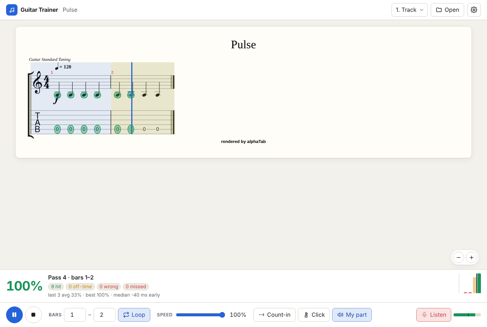

# Guitar Trainer

Practice guitar parts from your own Guitar Pro / MusicXML files, section by section, with real-time feedback from the microphone: notes light up **green** (right note, on time), **yellow** (right note, early/late) or **red** (wrong or missed), and every loop pass gets a score so you can watch yourself improve.

Runs entirely in the browser (Vite + TypeScript, no backend) and installs as a PWA, so it works offline on your phone once loaded.



## Features

- **Open any score you own** — drag-and-drop or file picker for `.gp` (GP7/8), `.gp3`, `.gp4`, `.gp5`, `.gpx`, `.musicxml`, `.xml`, `.mxl`. Files never leave your device; no song content ships with the app.
- **Tab + standard notation** rendered by [alphaTab](https://alphatab.net), with synth playback, a moving cursor and a track picker.
- **Practice controls** — loop a bar range (type it in, or drag across the score), speed 40–100 % without pitch change, count-in, metronome, mute your own part, backing volume.
- **Microphone feedback** — onset detection + McLeod/YIN-family pitch detection ([pitchy](https://github.com/ianprime0509/pitchy)) in a Web Worker, matched against the score within a timing window (default ±120 ms) and pitch tolerance (default ±50 cents).
- **Latency calibration** — a short clap-on-the-click step; the result is stored on the device.
- **Per-pass score** — % hit, counts of off-time / wrong / missed notes, median timing offset, and a bar per pass.

## Run it

Requires Node 20.19+ (22 recommended).

```bash
npm install
npm run dev        # http://localhost:5173
npm test           # unit tests (Vitest)
npm run build      # type-check + production build into dist/
npm run preview    # serve dist/ locally
```

The microphone only works on `localhost` or over HTTPS. To try it on a phone, use the GitHub Pages deployment (below) — a LAN address like `http://192.168.x.x:5173` is not a secure context, so browsers block the mic there.

## Use it

1. **Open** a score (button, drag-and-drop, or — once installed on desktop — "Open with Guitar Trainer").
2. Pick your **track** (top right) and the **bars** to loop (bottom bar, or drag-select in the score). Loop is on by default.
3. Set the **speed**; keep **Count-in** on to get a bar of clicks before each start.
4. Press **Listen** and allow the microphone. Use headphones, or switch off **My part**, so the mic hears your guitar rather than the synth.
5. Press **Play** (or Space) and play along. Notes are coloured as you play; after each pass of the loop the score panel shows how it went.

Notes are judged per onset: a chord or double-stop counts as one event. A note is *missed* if nothing with the right pitch was heard within ±2.5 × the timing window (at least ±250 ms).

## Calibrate latency

Between the moment a note is due and the moment the app hears you there is output latency (speakers/headphones) plus input latency (microphone). Calibrate once per device and audio setup — and again if you switch between speakers, wired and Bluetooth headphones:

1. Open **Settings → Calibrate…** (or the banner shown until you have calibrated).
2. Use the same speakers/headphones you practice with. Press **Start**.
3. After four count-in clicks, **clap or pick a muted string exactly on each of the next 8 clicks**.
4. The dialog shows the measured latency and its spread (e.g. `Latency 142 ms (±9 ms, 8/8 clicks)`). If the spread is large, try again; then **Save**.

The value is stored in `localStorage` (every access is wrapped in try/catch — in private mode it just won't persist). You can also type a value in Settings. If the score panel keeps saying you are consistently early or late by a similar amount, adjust the latency by that amount.

## Deploy to GitHub Pages

`.github/workflows/deploy.yml` builds, tests and publishes `dist/` on every push to `main`:

1. In the repository go to **Settings → Pages** and set **Source: GitHub Actions** (one-time).
2. Merge to `main` (or run the workflow manually from the Actions tab).
3. Open `https://<user>.github.io/<repo>/` — for this repo: <https://gilamran.github.io/guitar-trainer/>. On a phone, use "Add to Home Screen" / "Install app".

The build sets `BASE_PATH=/<repo>/`; for a custom domain or user site, set `BASE_PATH=/`. `ci.yml` runs type-check, tests and a build on pull requests.

## How it works

```
src/
  score/      file formats, alphaTab view, timeline extraction, tempo map
  audio/      mic capture, pitch/onset detection (worker), clock sync, calibration
  matching/   pure note matcher + per-pass scoring
  practice/   session: loop passes, time alignment, live + final judging
  ui/         app controller, overlay, dialogs, styles
  settings.ts persisted settings (localStorage, never throws)
```

Dependencies only point "down": `ui → practice → {score, audio, matching}`; `matching` has no DOM or audio code at all.

**Score → expected notes.** `score/timeline.ts` walks alphaTab's playback tick lookup for the chosen track: repeats are unrolled in playback order, notes starting on the same tick (voices, chords) become one event, tied continuations and dead notes are skipped, and swing (triplet feel) is respected. A tempo map converts ticks to milliseconds.

**Microphone → detected notes.** An AudioWorklet forwards raw samples (echo cancellation, noise suppression and auto-gain disabled) with audio-clock timestamps; a worker runs the analysis per 256-sample hop:
- *Onsets* from a rise in a peak envelope (plain or pre-emphasized for bright pick attacks) over an adaptive noise gate; quiet re-picks of a ringing string are confirmed by the drop in periodicity a restarted string causes; hammer-ons/pull-offs/slides are caught as sustained pitch jumps.
- *Pitch* is the mean of agreeing estimates after the attack. If the previous note still rings (cross-string lines), its harmonics are cancelled with a comb filter first — otherwise a mono detector reports the two notes' common sub-harmonic.

**Time alignment.** Everything is mapped onto `performance.now()`: mic samples through a clock sync that tracks the audio clock (and adopts jumps after audio glitches), playback through alphaTab's position events (which follow the samples actually played). Each expected note is placed using the playback positions around its own tick, so a playback hiccup mid-loop doesn't misjudge the rest of the pass. Detections are shifted by the calibrated latency.

**Matching** (`matching/matcher.ts`, pure, unit-tested with synthetic note streams) is a monotone alignment: every plausible (expected, detected) pair gets a weight — *hit* > *early/late* > *wrong pitch on time* — and the matcher picks the non-crossing set of pairs with maximum total weight (sparse DP with a Fenwick tree, `O(P log D)`). Misses and extra detections are free, so noise, double triggers and the individual strings of a strum don't hurt, and one late note can't "steal" the onset of the next one the way greedy nearest-neighbour matching can. During playback the same function runs with a `now` cut-off: notes whose window hasn't closed yet stay *pending* instead of red.

### Phase 2: chords / polyphony (not built yet)

The architecture is ready for a polyphonic detector such as Spotify's basic-pitch running in the browser:

- Detected events already carry `pitches: number[]`; the mono detector just emits one.
- A polyphonic detector implements the same `NoteDetector` interface (`audio/note-detector.ts`) and can be swapped in without touching the session, matcher or UI.
- The matcher's chord policy already supports `root` (timing + root note) and `timing-only`, intended for chord-heavy sections; with the mono detector the default for multi-note events is `any-tone` (timing + any chord tone, octave-insensitive).

## Known limitations

- **Single notes first.** Detection is monophonic. Chords are judged leniently (timing + any chord tone); let-ring passages with three or more strings sounding confuse pitch detection.
- **Speaker bleed.** Without headphones the mic hears the synth too; switch off **My part** or use headphones.
- **Timing accuracy** depends on calibration. Bluetooth headphones add large and sometimes variable latency — prefer wired.
- **Pitch details** — bends are judged at the pre-bend pitch, slides by the target note, harmonics by their sounding pitch; very short grace notes are often missed.
- **iOS Safari**: opening the microphone can switch audio output to the earpiece or lower the playback volume (iOS audio-session behaviour); headphones avoid it. Audio needs a tap to start, as everywhere on iOS.
- **Loop range** snaps to whole bars; a range that spans a repeat plays through the repetitions in playback order.
- The synth soundfont is small and general-MIDI quality — it is there for reference playback, not tone.

## Credits and licenses

- [alphaTab](https://github.com/CoderLine/alphaTab) (MPL-2.0) — rendering and synth; ships the [Bravura](https://github.com/steinbergmedia/bravura) font (SIL OFL 1.1) and the SONiVOX soundfont (Apache-2.0).
- [pitchy](https://github.com/ianprime0509/pitchy) (MIT) — pitch detection.
